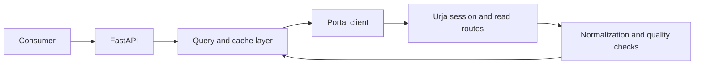

# Urja Meter API

A read-only HTTP API over the **Urja Meter Ops** smart-meter portal. Consumers get typed JSON for meter details, network membership, locations and recent energy readings without logging into the original website.

The service uses the portal's normal session login and browser-accessible data routes. A signed bulk export supplies the complete meter catalog; transformer pages supply the directory; readings are fetched on demand. There is no browser automation at runtime.

## Start here

Requires **Python 3.11+**. Python 3.12 is recommended. No database, paid service or API key is needed for the synthetic demo.

From this repository's root:

```sh
python3 -m venv .venv
source .venv/bin/activate
python -m pip install -r requirements.lock
python -m pip install --no-deps -e .
cp .env.example .env
uvicorn urja_api.app:app --host 127.0.0.1 --port 8000
```

Open [interactive API documentation](http://127.0.0.1:8000/docs), or try:

```sh
curl 'http://127.0.0.1:8000/v1/meters?status=Installed&limit=2'
curl 'http://127.0.0.1:8000/v1/meters/DEMO-001'
curl 'http://127.0.0.1:8000/v1/meters/DEMO-001/readings?limit=2'
```

The copied environment file selects **synthetic demo mode**, with 12 clearly named demo meters. Every response identifies `freshness.source` as `synthetic_demo`. Demo data is generated locally; it is not a downloaded copy of portal data.

### Connect to the real portal

Edit `.env`:

```dotenv
URJA_DEMO=false
URJA_USERNAME=<username supplied with the assignment>
URJA_PASSWORD=<password supplied with the assignment>
```

Restart the server, then:

```sh
curl 'http://127.0.0.1:8000/v1/summary'
curl 'http://127.0.0.1:8000/v1/meters?q=J100000'
curl 'http://127.0.0.1:8000/v1/meters/J100000/readings?limit=2'
```

The initial data request logs in and loads the catalog. No credentials are committed. `.env` is ignored by Git and Docker. Live mode fails at startup if credentials are absent; it never silently substitutes demo data.

Set `URJA_API_KEY` to protect `/v1` routes and pass `X-API-Key: <your-key>` on requests. The local default has no key. The OpenAPI security scheme and Swagger **Authorize** button support this header. Bind to localhost for local evaluation. A public deployment additionally needs TLS, authorization appropriate to its users, and ingress rate limiting.

## API

| Method and route | Purpose |
| --- | --- |
| `GET /healthz` | Process liveness; no portal request |
| `GET /v1/summary` | Inventory counts, status/make breakdowns and issue counts |
| `GET /v1/meters` | Search and filter the full inventory |
| `GET /v1/meters/{meter_id}` | Nameplate, coordinates, hierarchy and quality issues |
| `GET /v1/meters/{meter_id}/readings` | Normalized registers and valid interval consumption |
| `GET /v1/transformers` | Paginated complete transformer directory |
| `GET /v1/network` | Observed hierarchy graph, aliases and inconsistencies |
| `GET /openapi.json` | Generated OpenAPI 3.1 contract |
| `GET /docs` | Swagger UI |

The checked-in [openapi.json](openapi.json) is generated from the same routes and models used at runtime. [PROTOCOL.md](PROTOCOL.md) documents the original portal, while [REFLECTION.md](REFLECTION.md) explains the implementation process. [VERIFICATION.md](VERIFICATION.md) records checks and their limits.

### Query examples

`q` matches a meter ID or serial substring. `make`, `status`, `phase`, and `transformer_code` are case-insensitive exact filters. Filters combine with AND and apply before pagination.

```sh
curl --get 'http://127.0.0.1:8000/v1/meters' \
  --data-urlencode 'make=Genus' --data-urlencode 'status=Installed' \
  --data-urlencode 'phase=three' --data-urlencode 'limit=20'

curl --get 'http://127.0.0.1:8000/v1/meters' \
  --data-urlencode 'latitude=26.9' --data-urlencode 'longitude=75.8' \
  --data-urlencode 'radius_km=5'

curl --get 'http://127.0.0.1:8000/v1/meters/J100000/readings' \
  --data-urlencode 'start=2026-06-24T00:00:00+05:30' \
  --data-urlencode 'end=2026-06-24T23:30:00+05:30'
```

The three geographic parameters must be supplied together. Distances use the haversine formula. Results sort by distance then ID for geographic queries, otherwise by ID. `offset` is zero-based; catalog `limit` defaults to 50 and is capped at 200. A page beyond the end is an empty list with the correct total. Snapshot refreshes may move offset boundaries; stable cross-refresh cursors are not implemented.

### Readings are cumulative registers

The portal returns kWh/kVAh values that increase over time. This service exposes them as `cumulative_kwh` and `cumulative_kvah`. It computes `interval_kwh` only when adjacent, unique timestamps are exactly 30 minutes apart, both kWh values are valid, and the register has not decreased. Zero is a valid reading. Missing values, malformed timestamps, duplicate timestamps, gaps and resets are preserved or flagged; no consumption is invented to fill a gap.

A typical demo reading excerpt:

```json
{
  "timestamp": "2026-06-30T00:30:00+05:30",
  "raw_timestamp": "30/06/2026 00:30",
  "cumulative_kwh": 1000.4,
  "cumulative_kvah": 1080.43,
  "voltage_r_v": 226.0,
  "interval_kwh": 0.4,
  "issues": []
}
```

`start` and `end` are inclusive, require timezone offsets, and filter the **already available portal default window**. They do not request additional history. `available_from` and `available_to` show that window. The first filtered reading has no delta. Summaries cover the entire filtered window before pagination; `valid_interval_kwh` is a sum of accepted deltas, not a total of register values or a claim of complete billed consumption. Readings use a default limit of 500, capped at 2,000. A page after the first can legitimately start with a delta computed against a preceding row outside that page.

Portal timestamps have no timezone. `Asia/Kolkata` is an explicit assumption based on the Jaipur network; `URJA_PORTAL_TIMEZONE` can change it. Register interpretation and cadence are also observed assumptions, not vendor guarantees.

### Network quality

Node identity is `(level, code)`. Nodes expose all observed names and parent IDs, so consumers can inspect a graph without accepting an incorrect tree. Missing-code identities are provisional hashes of the level's parent identity and label; no code is inferred from a name. `meter_count` is distinct meters observed at that node. Names from the transformer directory are retained as additional aliases. Directory-versus-meter feeder disagreements are flagged, without inserting invented edges.

The graph includes entities observed along meter paths, not an authoritative inventory of all possible network assets. All directory transformers remain accessible through `/v1/transformers`, including any without a meter.

## Structure and trade-offs

```text
urja_api/
  app.py         HTTP routes, validation, errors, API-key check, OpenAPI
  portal.py      Cookie session, HMAC export, bounded retries and renewal
  normalize.py   Meter/readings normalization, distances and network graph
  service.py     Complete catalog snapshots and bounded readings cache
  models.py      Public response schemas
  config.py      Environment configuration and secret fields
  demo.py        Deterministic synthetic portal substitute
scripts/         OpenAPI generation and opt-in live verification
tests/           Offline protocol, service, normalization and HTTP tests
```



**HTTP over browser automation.** The browser's own JavaScript reveals the necessary read protocol. A persistent HTTPX client is smaller, faster and easier to test than an automated browser. The observed bulk export already normalizes both legacy and v2 nameplates, avoiding brittle HTML parsing and an extra request per meter.

**Full export with validation.** One signed export returned all 403 meters in the inspected instance. The adapter requires `total == len(data)` and unique IDs before installing a snapshot. It fails clearly if the upstream switches to a partial response; it does not guess an export pagination contract. Transformer pages are traversed explicitly and their totals checked. Multiple endpoint reads are not an atomic transaction at the portal, so a concurrent upstream edit could still create a cross-endpoint inconsistency.

**Simple local query layer.** An in-memory ID index supports direct lookups; collection filters scan the snapshot. This is appropriate for hundreds or a few thousand meters. Around 100,000 meters, full JSON materialization, O(N) scans, network serialization and per-worker copies would warrant measurement and likely replacement with a persistent indexed catalog. The next step would be SQLite for one local process or PostgreSQL/PostGIS for concurrent spatial queries, plus a background sync job. That threshold is a planning estimate, not a benchmark.

**Freshness is explicit.** Catalogs live for 300 seconds; per-meter readings for 60 seconds, with an LRU cap of 128 meters. TTLs use a monotonic clock. Response timestamps describe fetch time and expiry, not the source measurement's freshness. Expiry triggers a blocking refresh; a failed refresh returns an error instead of silently serving stale data. A new catalog is published only after all components pass validation. Locks coalesce concurrent cold requests, and upstream traffic is serialized to keep the portal load modest. Each process has its own caches; run one worker for this take-home.

**Bounded recovery.** The client retries transient GET failures at most twice after the initial attempt, handles `Retry-After`, and renews the session and signing key once after an authentication/signature rejection. Login itself is not transiently retried. HTTP operations have finite timeouts and catalog/readings refresh stages have overall deadlines. Unexpected bodies become a controlled error. Session cookies and export secrets stay in process memory.

**Errors.** Responses use `{ "error": { "code", "message", "request_id" } }`. Invalid input is 422, a missing meter is 404, service API-key failure is 401, portal protocol/authentication failure is 502, temporary unavailability is 503, and timeouts are 504. Error responses do not relay portal bodies or credentials. Every response has an `X-Request-ID`; data is marked `Cache-Control: no-store` for downstream clients.

### Configuration

| Variable | Default | Meaning |
| --- | --- | --- |
| `URJA_DEMO` | `false` in code; `true` in the example file | Explicit synthetic mode |
| `URJA_BASE_URL` | `https://urja-ops.flockenergy.tech` | HTTPS portal origin |
| `URJA_USERNAME`, `URJA_PASSWORD` | empty | Required in live mode |
| `URJA_API_KEY` | empty | Optional key protecting all `/v1` routes |
| `URJA_CATALOG_TTL_SECONDS` | `300` | Catalog cache lifetime |
| `URJA_READINGS_TTL_SECONDS` | `60` | Per-meter readings cache lifetime |
| `URJA_PORTAL_TIMEZONE` | `Asia/Kolkata` | Assumed timezone for source timestamps |
| `URJA_TIMEOUT_SECONDS` | `15` | HTTPX connect/read/write/pool timeout |
| `URJA_OPERATION_TIMEOUT_SECONDS` | `60` | Deadline for a portal operation or refresh stage |

A readings request on a completely cold service can require both a catalog and readings refresh stage. These stage deadlines are separate. TLS verification remains enabled, redirects are not followed automatically, and the portal origin is fixed by configuration rather than accepted from API callers.

## Verification and development

```sh
python -m pip install -r requirements-dev.lock
python -m pip install --no-deps -e .
pytest -q
ruff check .
ruff format --check .
python scripts/export_openapi.py
git diff --exit-code openapi.json
```

Tests make **no network calls** and require no secrets. They cover the real protocol shape through mock HTTP transports, session renewal, HMAC signing, malformed responses, throttling, timeout recovery, completeness, cache expiry/concurrency, hierarchy conflicts and energy edge cases. CI runs the offline suite and checks OpenAPI drift. Dependency lock files record exact verified versions; `pyproject.toml` defines supported package ranges.

For an explicit, low-volume live check with credentials in `.env`:

```sh
python scripts/smoke_live.py
```

This performs a catalog read plus one readings request per source build. It prints summary counts, not credentials. It does not modify portal business data.

Optional container setup:

```sh
docker build -t urja-api .
docker run --rm --env-file .env -p 127.0.0.1:8000:8000 urja-api
```

The container runs as a non-root user. Container execution was not part of the local verification; see [VERIFICATION.md](VERIFICATION.md).

## Scope and next steps

Included: all core API/documentation deliverables, complete bulk inventory, network reconstruction with quality flags, local filtering and nearby search, explicit cache freshness, bounded authentication recovery, offline demo, tests and CI.

Intentionally omitted: a custom modern frontend (Swagger covers API exploration), arbitrary historical consumption retrieval (no verified date-range protocol), write operations (out of scope), automatic hierarchy repair (insufficient evidence), a database/background scheduler (unnecessary at this scale), and production tenant/user authorization (the assignment provides one operator account).

With more time: verify date-window semantics through additional normal UI workflows; test more meters and real expiry behavior; add source timestamps, refresh metrics and request tracing; persist the catalog with spatial indexes; then build a small interface that makes hierarchy conflicts and missing intervals easy to inspect. A supported upstream API would ultimately be preferable to relying on undocumented portal routes.

## Authorship and reflection

This implementation was prepared with AI assistance, including investigation, coding and verification. [REFLECTION.md](REFLECTION.md) records that process accurately; it does not claim an unaided personal investigation. The assignment's guidance-only AI rule should be considered before submitting this implementation.

